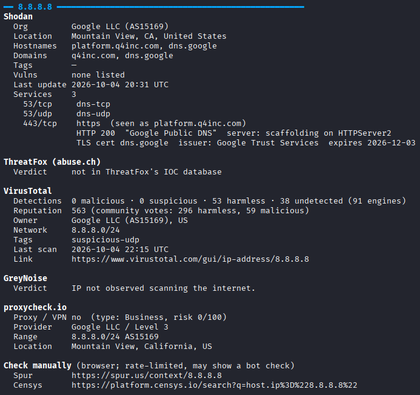
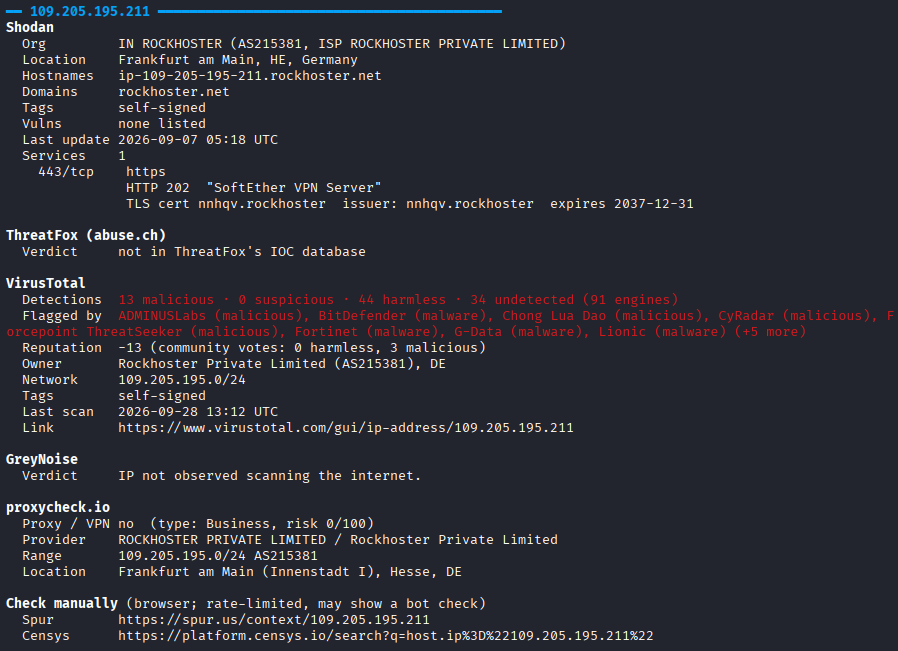
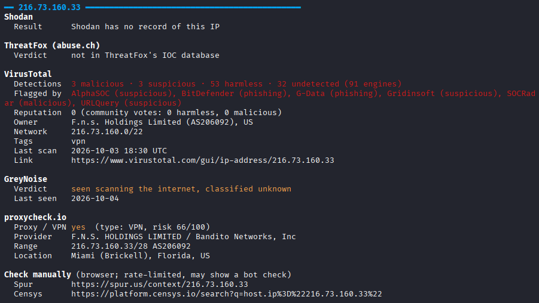

# ipIntel

Look up an IP address in Shodan, ThreatFox, VirusTotal, GreyNoise and proxycheck.io from the terminal, with Spur and Censys links to check manually.

One file, Python 3.8+ standard library only. No `pip install`.

## Example output (all suspicious IPs were chosen at random from vendor blog posts)

**A well-known benign service.** All sources agree. Shodan lists the open DNS and HTTPS services, no antivirus engine flags it, and it isn't a proxy.



**A flagged hosting IP.** 13 VirusTotal engines flag it as malicious, and Shodan shows why it deserves a closer look: a SoftEther VPN server with a self-signed certificate. proxycheck.io doesn't list it as a proxy, which is why it helps to see several sources side by side.



This is a good use case for the Censys link. Censys runs its own internet-wide scans, so it gives a second view of the open services and the self-signed certificate, and you can search for other servers presenting that same certificate to find related infrastructure.

**A VPN exit.** proxycheck.io identifies it as a VPN (risk 66/100), GreyNoise has seen it scanning the internet, and VirusTotal tags it `vpn`. Shodan has no record of it.



This is a good use case for the Spur link. Spur specializes in VPN and proxy infrastructure, so its page shows the infrastructure type, the IP's anonymization behavior (often naming the VPN service), observed risks and exit location. That tells you whose service the traffic came through, not just that it was a VPN.

Red marks clear bad signs, such as detections, CVEs, ThreatFox listings and expired certificates. Yellow marks things worth a look, such as suspicious verdicts and proxy or VPN hits. Green marks known-good services.

## Setup

Clone this repository, or download just `ipIntel.py`, and run it with `python3`. Nothing else to install. For example, to look up a single IP:

```bash
python3 ipIntel.py 8.8.8.8
```

To run it directly as `./ipIntel.py`, make it executable once with `chmod +x`:

```bash
chmod +x ipIntel.py
./ipIntel.py 8.8.8.8
```

## API keys

Shodan, ThreatFox and VirusTotal each need an API key.

```bash
python3 ipIntel.py --init
```

That prompts for each key in turn. Input is hidden, and you can press Enter to skip one. To set or replace just one key, use `--init shodan`, `--init threatfox` or `--init virustotal`. Each key is checked with the service before it's saved with owner-only permissions.

| Service | Where to get a key | Saved to |
|---|---|---|
| Shodan | An API key from https://account.shodan.io | `~/.config/shodan/api_key` |
| ThreatFox | An abuse.ch Auth-Key from https://auth.abuse.ch | `~/.config/ipintel/abusech_auth_key` |
| VirusTotal | Sign up at https://www.virustotal.com/gui/join-us; the key is in your account settings | `~/.config/ipintel/virustotal_api_key` |

`python3 ipIntel.py --account` checks every saved key and shows your Shodan plan and credits, your VirusTotal lookups used today, this hour and this month, and whether your abuse.ch key is accepted. abuse.ch publishes no usage quota. None of these checks use up any lookups, and `--init` uses the same checks to confirm a new key.

abuse.ch offers ThreatFox under fair-use terms and notes that commercial use may require a paid subscription. Check their terms for your organisation.

VirusTotal's free public API allows 4 lookups a minute and 500 a day, and its terms say it "must not be used in business workflows that do not contribute new files". For work use, check whether your organisation needs a premium key. When several IPs are looked up in one run, VirusTotal lookups are spaced 15 seconds apart to stay within the per-minute limit.

## Usage

```bash
python3 ipIntel.py 8.8.8.8
python3 ipIntel.py 8.8.8[.]8 1.1.1.1              # defanged IPs are fine
python3 ipIntel.py -f iocs.txt                    # one or more IPs per line, # comments ok
python3 ipIntel.py 8.8.8.8 -s shodan,virustotal   # only some sources
python3 ipIntel.py -f iocs.txt --json > out.json  # raw data for jq / scripts
```

Run `python3 ipIntel.py -h` for every option.

Private and reserved addresses (10.x, 192.168.x, 127.x…) are skipped.

## Sources

| Source | What it tells you | Limits |
|---|---|---|
| Shodan host *(API key required)* | Open ports, product versions, HTTP titles, TLS certs, hostnames, CVEs, last seen | ~1 request/sec, retried once if Shodan rate-limits |
| ThreatFox *(API key required)* | Whether the IP is a known malware or C2 indicator: malware family, threat type, confidence, first/last seen, tags, link to the entry | Fair use |
| VirusTotal *(API key required)* | How many antivirus engines flag the IP and which, community reputation and votes, owner/ASN, network, tags, last scan, link to the report | Public API: 4/min, 500/day |
| GreyNoise Community | Is this IP mass-scanning the internet? Malicious/benign? Known good service? | Small daily allowance |
| proxycheck.io | Proxy/VPN verdict, risk score, VPN operator name | ~100/day |
| Spur, Censys | Printed as links only. Both sites block scripts, so open them in a browser | Daily limits on their side |

CVEs from Shodan are inferred from software versions and are **not verified** to be exploitable.

## Security

- **Key files** are written atomically with `600` permissions. The script warns if other users can read one and ignores it if another user owns it. `--init` reads keys from a hidden prompt, so they never land in shell history.
- **VirusTotal lookups are visible to its community.** VirusTotal's docs say any IOC queried through the API "will be scanned and added to the VirusTotal dataset". If an investigation is sensitive, for example where an attacker might watch for lookups of their infrastructure, leave it out with `-s`.

## License

MIT. See [LICENSE](LICENSE).
